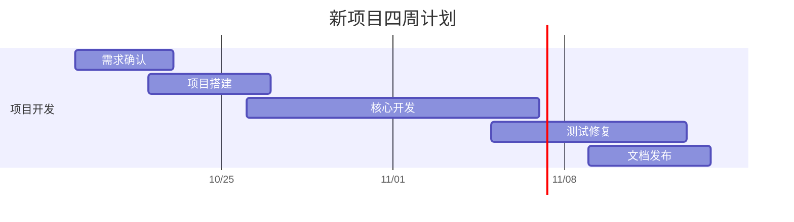

# gantt-chart

[](https://github.com/qiao-416/gantt-chart/actions/workflows/update-gantt.yml)

一个简单的四周项目甘特图。修改 `schedule.json`，GitHub Actions 就会自动更新下面的图表与 `docs/gantt.mmd`。

## 甘特图

<!-- GANTT:START -->

更新日期：**2026-10-15（UTC）**。今日处于计划日期内的任务：无。



任务状态来自 `schedule.json`；每日更新不会自动认定任务已完成。

<!-- GANTT:END -->

## 修改排期

在 [schedule.json](schedule.json) 中编辑或添加任务，然后提交到 `main`：

```json
{
  "name": "需求确认",
  "start": "2026-10-19",
  "end": "2026-10-22",
  "status": "planned"
}
```

- `name`：任务名称。
- `start` / `end`：开始和结束日期，格式为 `YYYY-MM-DD`，按自然日计算，包含首尾两天。
- `status`：`planned`（待开始）、`active`（进行中）、`done`（已完成）。状态由维护者填写，不会因日期经过而自动变成已完成。

可同时修改多个任务。任务按 `schedule.json` 中的顺序展示，日期重叠表示可以并行。
标题与名称请使用单行文本，不包含 Mermaid 分隔符 `:`、`;`、反引号或 HTML 标签。

## 自动同步

工作流：[Update Gantt](.github/workflows/update-gantt.yml)。

- **修改后更新**：向 `main` 推送排期、生成脚本、测试、README 或工作流的修改。
- **定时更新**：每日 06:17 UTC（伦敦冬季 06:17，夏季 07:17），刷新日期和当天处于计划窗口内的任务。
- **手动更新**：打开仓库 **Actions → Update Gantt → Run workflow**。

每次运行先校验排期并执行测试，再生成图表；只有内容变化时才由 `github-actions[bot]` 提交到 `main`。
自动生成区位于 `GANTT:START` 与 `GANTT:END` 之间，区外的说明会保留。请在源文件中修改排期。

工作流使用仓库自带的 `GITHUB_TOKEN` 与 `contents: write` 权限，无需额外配置个人令牌。
如果以后对 `main` 启用禁止直接推送的分支规则，需要相应调整发布流程。
GitHub 的定时任务可能延迟；公开仓库连续 60 天没有活动时，定时工作流可能被自动停用，可在 Actions 中重新启用。

## 本地运行

需要 Python 3.10 或更高版本，无第三方依赖。在仓库根目录执行：

```bash
python scripts/update_gantt.py
python -m unittest discover -s tests -v
```

用于复现某一天的输出：

```bash
python scripts/update_gantt.py --date 2026-10-26
```

默认使用 UTC 日期。GitHub 直接渲染 Mermaid 图表，原始图表文件在 [docs/gantt.mmd](docs/gantt.mmd)。

## 参考

- [GitHub Mermaid 图表](https://docs.github.com/en/get-started/writing-on-github/working-with-advanced-formatting/creating-diagrams#creating-mermaid-diagrams)
- [Mermaid Gantt 语法](https://mermaid.js.org/syntax/gantt.html)
- [GitHub 定时工作流](https://docs.github.com/en/actions/reference/workflows-and-actions/events-that-trigger-workflows#schedule)
- [GITHUB_TOKEN](https://docs.github.com/en/actions/concepts/security/github_token)
