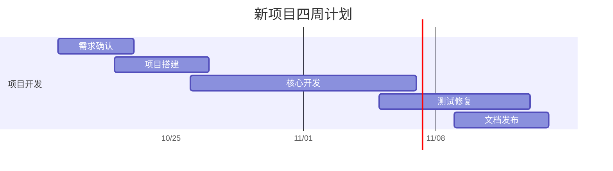

# gantt-chart

[](https://github.com/qiao-416/gantt-chart/actions/workflows/update-gantt.yml)

一个带独立界面的四周项目甘特图。修改 `schedule.json`，GitHub Actions 会同步更新 README、`docs/gantt.mmd` 和 GitHub Pages 网页。

**[打开独立甘特图界面 ↗](https://qiao-416.github.io/gantt-chart/)**

界面采用任务表格与每日时间轴并排的布局，支持紫、粉、绿色阶段分组、负责人、进度、开始/结束日期、今日标线、阶段折叠和时间轴缩放。
点击任务或色条可编辑，也可添加任务、导入/导出排期。手机上保留任务和进度列，横向滚动查看时间轴；其他字段可在编辑窗口查看。

网页修改会保存为当前浏览器的本机草稿。点击「导出排期」，把 JSON 内容提交到仓库的 `schedule.json`，Actions 就会更新线上界面。浏览器不会直接写入仓库，也不需要保存 GitHub 令牌。

## 甘特图

<!-- GANTT:START -->

更新日期：**2026-10-26（UTC）**。今日处于计划日期内的任务：项目搭建、核心开发。



任务状态来自 `schedule.json`；每日更新不会自动认定任务已完成。

<!-- GANTT:END -->

## 修改排期

在 [schedule.json](schedule.json) 中编辑或添加任务，然后提交到 `main`：

```json
{
  "name": "需求确认",
  "assigned_to": "未分配",
  "group": "initiation",
  "progress": 0,
  "start": "2026-10-19",
  "end": "2026-10-22",
  "status": "planned"
}
```

- `name`：任务名称。
- `assigned_to`：负责人，未指定时显示「未分配」。
- `group`：阶段 ID，对应根节点 `groups` 中的 `id`。每个阶段配置名称与 `purple`、`pink` 或 `green` 颜色。
- `progress`：实际完成百分比，0–100 的整数。填写后作为进度来源，网页和 README 均据此确定任务状态。
- `start` / `end`：开始和结束日期，格式为 `YYYY-MM-DD`，按自然日计算，包含首尾两天。
- `status`：`planned`（待开始）、`active`（进行中）、`done`（已完成）。旧排期未提供 `progress` 时使用此字段；网页导出时会保持两者一致。任务不会因日期经过而自动变成已完成。

可同时修改多个任务。任务按 `schedule.json` 中的顺序展示，日期重叠表示可以并行。
标题与名称请使用单行文本，不包含 Mermaid 分隔符 `:`、`;`、反引号或 HTML 标签。

## 自动同步

工作流：[Update Gantt](.github/workflows/update-gantt.yml)。

- **修改后更新**：向 `main` 推送排期、生成脚本、测试、README 或工作流的修改。
- **定时更新**：每日 06:17 UTC（伦敦冬季 06:17，夏季 07:17），刷新日期和当天处于计划窗口内的任务。
- **手动更新**：打开仓库 **Actions → Update Gantt → Run workflow**。

每次运行先校验排期并执行 Python 和 JavaScript 测试，再生成图表；只有内容变化时才由 `github-actions[bot]` 提交到 `main`。随后构建独立界面，通过 GitHub Pages 发布。
自动生成区位于 `GANTT:START` 与 `GANTT:END` 之间，区外的说明会保留。请在源文件中修改排期。

工作流使用仓库自带的 `GITHUB_TOKEN`：图表同步任务使用 `contents: write`；网页发布任务使用 `pages: write` 和 `id-token: write`。无需额外配置个人令牌。仓库 Pages 的发布来源应设为 GitHub Actions。
如果以后对 `main` 启用禁止直接推送的分支规则，需要相应调整发布流程。
GitHub 的定时任务可能延迟；公开仓库连续 60 天没有活动时，定时工作流可能被自动停用，可在 Actions 中重新启用。

## 本地运行

需要 Python 3.10+ 与 Node.js 20+，无需安装第三方依赖。在仓库根目录执行：

```bash
python scripts/update_gantt.py
python -m unittest discover -s tests -v
node --test tests/gantt-core.test.mjs
python scripts/build_site.py
python -m http.server 8765 --directory dist
```

打开 `http://localhost:8765` 预览独立界面。`site/` 是网页源文件，`dist/` 是自动生成的发布目录。

用于复现某一天的输出：

```bash
python scripts/update_gantt.py --date 2026-10-26
```

默认使用 UTC 日期。GitHub 直接渲染 Mermaid 图表，原始图表文件在 [docs/gantt.mmd](docs/gantt.mmd)。

## 参考

- [GitHub Mermaid 图表](https://docs.github.com/en/get-started/writing-on-github/working-with-advanced-formatting/creating-diagrams#creating-mermaid-diagrams)
- [Mermaid Gantt 语法](https://mermaid.js.org/syntax/gantt.html)
- [GitHub 定时工作流](https://docs.github.com/en/actions/reference/workflows-and-actions/events-that-trigger-workflows#schedule)
- [GITHUB_TOKEN](https://docs.github.com/en/actions/concepts/security/github_token)
